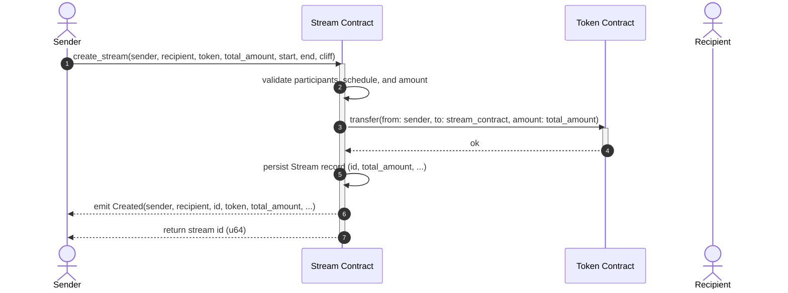
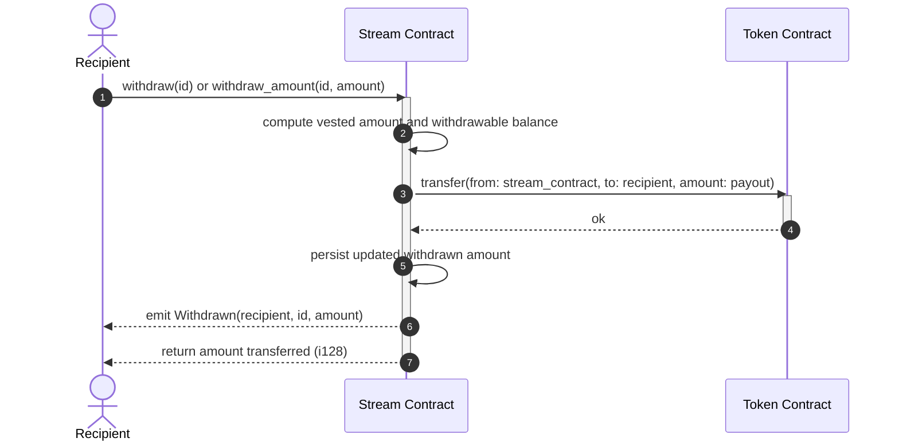
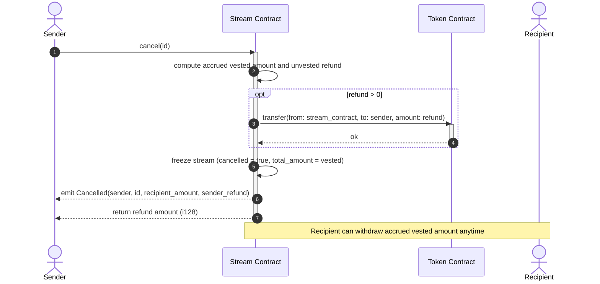
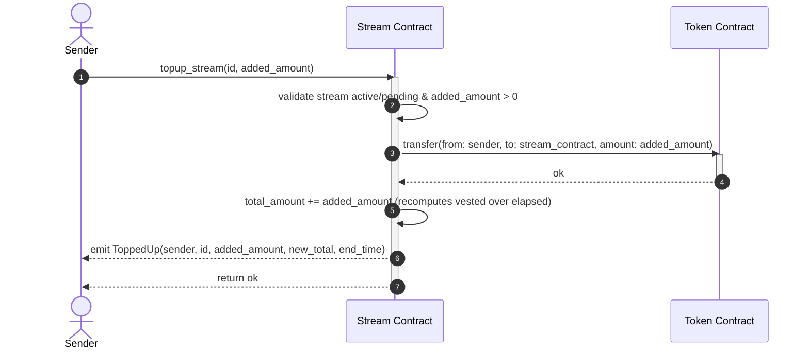

# TricklePay Contracts

[](https://github.com/TricklePay/tricklepay-contracts/actions/workflows/ci.yml)
[](LICENSE)

Soroban smart contracts for TricklePay, a token streaming protocol on Stellar.

A stream locks a sum of tokens from a sender and releases them to a recipient
linearly over time. The recipient can withdraw whatever has vested at any
moment; the sender can cancel and reclaim only the portion that has not yet
vested. This is the on-chain primitive behind payroll, vesting, grants, and
subscriptions, where value should move continuously rather than in lump sums.

**All stream data is public.** Every stream's participants, schedule, and
amounts are readable on-chain by anyone, not just the two parties involved —
see [THREAT_MODEL.md § What a third party can observe](THREAT_MODEL.md#what-a-third-party-can-observe)
before using this for payroll or any other arrangement where that information
is sensitive.

This repository holds the `stream` contract and its test suite. The indexer and
web client that build on it live in separate repositories; see
[Related repositories](#related-repositories).

Integrator-facing operational policies live in
[docs/INTEGRATOR_OPERATIONS.md](docs/INTEGRATOR_OPERATIONS.md). That guide
covers redeployment without upgradeability, interface stability, safe retry
behavior after uncertain submissions, and the practical duration limits imposed
by storage TTL.

A formal audit is the gate between this contract and production use (see
[SECURITY.md](SECURITY.md)). [docs/AUDIT_READINESS.md](docs/AUDIT_READINESS.md)
is the checklist of what must be in place — invariants, threat model, and test
coverage — before engaging an auditor.

Deliberate design trade-offs — things that look like missing features but
aren't — are recorded in [docs/DECISIONS.md](docs/DECISIONS.md), starting
with why there is no on-chain way to list a party's streams.

## Soroban SDK compatibility

The contract targets Soroban SDK `25.3.2`, pinned to an exact version (`=25.3.2`) in the workspace
`Cargo.toml`. The same version is used for the contract build and its test
host.

Upgrading the SDK can change generated contract clients and macros, the WASM
build, or host behavior exercised by tests. Review the SDK release notes,
update the workspace pin, and run the full test and lint suite. Also rebuild
and inspect the contract interface and WASM artifact before deployment, since
SDK changes can affect the contract ABI or what the Soroban host accepts.

### Pinned Stellar CLI version

The contract tools and scripts expect Stellar CLI version `25.2.0` to ensure protocol and XDR alignment with Soroban SDK `25.3.2`. Install the pinned CLI version with:

```bash
cargo install --locked stellar-cli --version 25.2.0
```

> **Compatibility Note:** CLI major and minor versions must align with the target Soroban SDK. Using a newer or mismatched Stellar CLI version can cause CLI flag deprecation warnings or XDR type parsing errors during inspection and deployment.

## How a stream works

**All timestamps are Unix seconds.** The `start_time`, `end_time`, and `cliff_time` parameters are `u64` Unix timestamps in seconds, matching the Soroban ledger clock (`env.ledger().timestamp()`). A caller using milliseconds (such as JavaScript's `Date.now()`) would create a stream that appears to never start, since a timestamp like `1735689600000` (January 1, 2025 in milliseconds) is interpreted as a date billions of years in the future when read as seconds. The contract does not validate timestamp magnitude or convert units; the caller must ensure all times are in seconds.
The decision to leave timestamp magnitude unbounded is recorded in
[ADR: Do Not Bound Timestamp Magnitude](docs/ADR_TIMESTAMP_MAGNITUDE.md).

**Concrete example:** To create a one-month stream starting on **January 1, 2025 at 00:00:00 UTC** and ending on **February 1, 2025 at 00:00:00 UTC**, convert both dates to Unix seconds:

- January 1, 2025 00:00:00 UTC = `1735689600` seconds since the Unix epoch (not `1735689600000` milliseconds).
- February 1, 2025 00:00:00 UTC = `1738368000` seconds.

Call `create_stream(sender, recipient, token, total_amount, 1735689600, 1738368000, 1735689600)` where `cliff_time == start_time` represents the no-cliff case. The ledger clock increments in seconds, so vesting progresses one second at a time from `start_time` toward `end_time`.

A stream is defined by a total amount and a window of time:

- **Start and end** bound the linear release. At the start nothing has vested;
  at the end the full amount has vested; in between the vested amount grows in
  proportion to elapsed time. The `end_time` must be strictly in the future at
  the moment `create_stream` is called — a window whose end has already passed
  is rejected with `StreamWindowInPast`. A window whose `start_time` is in the
  past but whose `end_time` is still in the future is accepted: the elapsed
  portion vests immediately, making it useful for backdated payroll or grants
  that should have started earlier.
- **Cliff** (optional) is a point before which nothing can be withdrawn. When
  the cliff is reached, everything accrued since the start unlocks at once and
  vesting continues linearly from there. `cliff_time` must fall inside
  `[start_time, end_time]`; anything outside is rejected with `InvalidCliff`

  **A stream has no cliff when `cliff_time == start_time`.** There is no
  separate flag or null value to pass — the cliff is always a timestamp, and
  setting it to the start makes the gate vacuous. `vested_amount` withholds
  everything while `now < cliff_time || now < start_time`, so when the two are
  equal that reduces to `now < start_time`: exactly the start check every
  stream already applies. The no-cliff case is not special-cased anywhere in
  the vesting math, it simply falls out of the same expression. This is the usual default when a stream should begin vesting immediately from `start_time` rather than waiting for an explicit cliff. `cliff_time == end_time` is equally valid and withholds everything until the window closes — a pure lockup that vests in one step.

  A no-cliff stream is what `create_stream(sender, recipient, token, 1000, 100,
  1100, 100)` opens, and it is the shape most of the contract tests use. Its
  schedule is tabulated under [Example schedule](#example-schedule) below.

- **Withdraw** sends the recipient whatever has vested minus what they have
  already taken. A partial withdrawal (`withdraw_amount`) names a figure
  instead and transfers exactly that, up to the same balance; whatever is left
  stays in the stream and keeps growing as more vests. The two can be mixed
  freely — draw a fixed sum each month, then sweep the remainder at the end.
  `withdraw_to(id, destination, amount)` works like `withdraw_amount` but sends
  the tokens directly to `destination` instead of the stream's `recipient`;
  only the `recipient` authorizes the call, and `destination` may be any
  address except the stream contract itself (which is rejected with
  `InvalidParticipant`).
  `withdraw_many(ids)` pays multiple streams in one call, including streams
  with different recipients (each distinct recipient authorizes once). Each
  stream with a positive balance is transferred and emits its own event;
  the returned amounts follow input order, zero-balance streams return `0`,
  and only the first occurrence of a duplicate id can pay. Batches accept up to
  20 ids. An unknown id fails the whole invocation, and a batch with no
  positive payout returns `NothingToWithdraw`.
- **Cancel** stops a stream early. The recipient keeps everything vested up to
  that moment; the unvested remainder is refunded to the sender. A cancelled
  stream's vested balance stays claimable.

### Lifecycle sequence diagrams

The following sequence diagrams illustrate the participant interactions, token transfers, state changes, and event emissions for the three primary stream lifecycle operations.

#### Create stream (`create_stream`)



#### Stream withdrawal (`withdraw` / `withdraw_amount`)



#### Third-party withdrawal (`withdraw_to`)

`withdraw_to(id, destination, amount)` lets the stream's `recipient` route vested tokens directly to any `destination` address (such as a cold wallet, vendor, or smart contract) in a single call:

- **Authorization:** Only the stream's `recipient` authorizes the call; `destination` does not need to sign or approve the transfer.
- **Destination rule:** `destination` cannot be the stream contract's own address (rejected with `InvalidParticipant`). Passing `destination == recipient` is permitted and behaves identically to `withdraw_amount`.
- **Errors:** Returns `StreamNotFound` if `id` does not exist, `InvalidAmount` if `amount <= 0`, `InvalidParticipant` if `destination` is the contract's own address, and `InsufficientBalance` if `amount` exceeds the current withdrawable balance.

```mermaid
sequenceDiagram
    autonumber
    actor Recipient
    participant StreamContract as Stream Contract
    participant TokenContract as Token Contract
    actor Destination

    Recipient->>StreamContract: withdraw_to(id, destination, amount)
    activate StreamContract
    StreamContract->>StreamContract: require recipient auth; validate amount > 0 & destination != contract
    StreamContract->>StreamContract: check amount <= withdrawable balance & update withdrawn
    StreamContract->>TokenContract: transfer(from: stream_contract, to: destination, amount)
    activate TokenContract
    TokenContract-->>Destination: credit amount
    TokenContract-->>StreamContract: ok
    deactivate TokenContract
    StreamContract-->>Recipient: emit Withdrawn(recipient, id, amount, destination)
    StreamContract-->>Recipient: return amount transferred (i128)
    deactivate StreamContract
```

#### Stream cancellation (`cancel`)



#### Top up stream (`topup_stream`)



`topup_stream` raises `total_amount` while keeping `start_time`, `end_time`, and `cliff_time` unchanged, so the vested amount is recomputed over the entire elapsed time since `start_time`. Once the cliff has passed, topping up causes the vested amount to jump retroactively in the same ledger by `added_amount * elapsed / duration` (subject to integer division rounding).

For example, take a stream of `1,000` tokens over `1,000` seconds (`start_time = 100`, `end_time = 1100`, `cliff_time = 100`) topped up by `1,000` tokens at the midpoint (`now = 600`, `elapsed = 500`):

- **Before top-up:** `total_amount = 1,000`, `vested = 500`, `withdrawable = 500`, `locked = 500`.
- **After top-up (`+1,000`):** `total_amount = 2,000`, `vested = 1,000` (`500 + 1,000 * 500 / 1,000`), `withdrawable = 1,000`, `locked = 1,000`.

A stream can also be read at any time without changing it. The vested and
`locked` amounts mirror each other and always sum to the total, while
`progress` reports the same ratio in basis points, from 0 to 10000, for
rendering a progress bar (for example, a value of 5000 means 50%). Cancelling
freezes the total at whatever had vested, so a cancelled stream reports nothing
locked and full progress (10000) even when it was stopped early. A stream with
a `total_amount` of zero also reports full progress (10000) at all times.

All amounts are in the token's smallest unit. All times are Unix timestamps in
seconds, matching the ledger clock.

### Read-only view functions

| View | Return type | Description |
| ---- | ----------- | ----------- |
| `get_stream(id)` | `Stream` | Fetch the full stream record. |
| `cancel_preview(id)` | `Settlement` | Preview sender refund and recipient remaining balance if cancelled at current ledger time without modifying state. |
| `get_streams(ids)` | `Vec<Option<Stream>>` | Fetch up to 20 streams in input order (`None` for missing or archived streams). |
| `stream_exists(id)` | `bool` | Check whether a stream record exists, including cancelled or completed streams. |
| `withdrawable(id)` | `i128` | Amount vested but not yet withdrawn. |
| `withdrawable_many(ids)` | `Vec<i128>` | Fetch up to 20 withdrawable amounts in input order; unknown ids return `0`. |
| `rate_per_second(id)` | `i128` | Nominal vested token base units per second, rounded down; `0` for cancelled streams. |
| `vested(id)` | `i128` | Total amount vested at the current ledger time. |
| `vested_at(id, timestamp)` | `i128` | Project the vested amount at a specified Unix timestamp. |
| `locked(id)` | `i128` | Amount not yet vested at the current ledger time. |
| `remaining_time(id)` | `u64` | Seconds until `end_time`, using ledger time; returns `0` when completed or cancelled. |
| `progress(id)` | `u32` | Vesting progress in basis points, from `0` to `10000`. |
| `status(id)` | `StreamStatus` | Lifecycle status at the current ledger time. |
| `stream_count()` | `u64` | Number of streams created so far. |
| `max_amount()` | `i128` | Maximum amount accepted by `create_stream`. |

`vested_at(id, timestamp)` uses the same calculation as `vested(id)` when
`timestamp` equals the current ledger time. Times before the start or cliff
return zero, and times at or after the end return the full amount. For a
cancelled stream, timestamps at or after cancellation return the amount vested
when it was cancelled. `stream_exists(id)` only checks whether a record is
stored; it does not write state or publish events.

`rate_per_second(id)` is the integer quotient of `total_amount` divided by the
stream duration in seconds. Any division remainder is not included in this
nominal per-second rate; the existing vesting calculation still distributes
the full `total_amount` by `end_time`. A cancelled stream reports a rate of
`0`. `withdrawable_many(ids)` returns amounts in the input order, uses `0` for
unknown ids, and rejects more than `MAX_BATCH_SIZE` ids with
`BatchTooLarge`. It is read-only and does not extend storage TTL.

### Stream lifecycle and status transitions

A stream's lifecycle is represented by `StreamStatus`, pure logic derived from the stream's schedule (`start_time`, `end_time`), the `cancelled` boolean, and the current ledger timestamp (`now`). Its transitions and triggers are asserted in [`status.rs`](contracts/stream/src/status.rs):

```mermaid
stateDiagram-v2
    [*] --> Pending: create_stream (now < start_time)
    [*] --> Streaming: create_stream (start_time <= now < end_time)

    Pending --> Streaming: [Time-driven] Ledger time reaches start_time (now >= start_time)
    Pending --> Cancelled: [Transaction] sender calls cancel() (refunds 100% of deposit)

    Streaming --> Completed: [Time-driven] Ledger time reaches end_time (now >= end_time)
    Streaming --> Cancelled: [Transaction] sender calls cancel() (refunds unvested; freezes vested)

    Completed --> [*]: Terminal state (cancel rejected: StreamAlreadyCompleted)
    Cancelled --> [*]: Terminal state (permanent: cancel rejected: AlreadyCancelled)
```



Key lifecycle rules:
1. **Time-driven vs. Transaction-driven**:
   - `Pending -> Streaming` and `Streaming -> Completed` transitions are **time-driven**. They occur automatically as ledger time advances past `start_time` and `end_time` respectively, requiring zero transactions or storage updates.
   - Transitions into `Cancelled` are **transaction-driven**. They require an authenticated on-chain invocation of `cancel(id)` by the stream's `sender`.
2. **Cancellation is permanent**:
   - Once cancelled (`cancelled == true`), `status(id)` permanently returns `StreamStatus::Cancelled` across all future timestamps.
   - Calling `cancel` on an already cancelled stream returns `StreamError::AlreadyCancelled` (code 6).
3. **Completed streams cannot be cancelled**:
   - Once ledger time reaches or passes `end_time` (`now >= end_time`), a stream is `Completed`.
   - Any subsequent call to `cancel` is rejected with `StreamError::StreamAlreadyCompleted` (code 9) because all funds have already vested.
4. **Cliff does not alter status**:
   - The optional `cliff_time` gates token withdrawal eligibility, not the lifecycle status. A stream before its cliff reports `StreamStatus::Streaming` as long as `now >= start_time`.

### Storage TTL extension behaviour of view functions

Not all view functions extend storage TTL. The contract deliberately distinguishes between individual stream reads and bulk/preview views:

| View Function | Access Helper | Extends TTL? | Rationale |
| :--- | :--- | :--- | :--- |
| `get_stream(id)` | `storage::get_stream` | **Yes** (if < `BUMP_THRESHOLD`) | Individual stream inspection; keeps active streams alive for participants. |
| `withdrawable(id)` | `storage::get_stream` | **Yes** (if < `BUMP_THRESHOLD`) | Standard withdrawal polling by recipient. |
| `rate_per_second(id)` | `storage::get_stream` | **Yes** (if < `BUMP_THRESHOLD`) | Individual rate query for a stream. |
| `vested(id)` | `storage::get_stream` | **Yes** (if < `BUMP_THRESHOLD`) | Real-time vesting calculation for individual stream. |
| `vested_at(id, timestamp)` | `storage::get_stream` | **Yes** (if < `BUMP_THRESHOLD`) | Schedule projection for individual stream. |
| `locked(id)` | `storage::get_stream` | **Yes** (if < `BUMP_THRESHOLD`) | Unvested balance query for individual stream. |
| `remaining_time(id)` | `storage::get_stream` | **Yes** (if < `BUMP_THRESHOLD`) | Remaining duration query using the current ledger timestamp. |
| `progress(id)` | `storage::get_stream` | **Yes** (if < `BUMP_THRESHOLD`) | Progress indicator query for individual stream. |
| `status(id)` | `storage::get_stream` | **Yes** (if < `BUMP_THRESHOLD`) | Status enum derivation for individual stream. |
| `cancel_preview(id)` | `storage::get_stream_readonly` | **No** | Off-chain simulation preview; side-effect-free, emits no ledger writes. |
| `get_streams(ids)` | `storage::get_stream_readonly` | **No** | Batch dashboard/indexer queries; avoids multi-entry write fees and keeps dormant streams expiring. |
| `withdrawable_many(ids)` | `storage::get_stream_readonly` | **No** | Batch dashboard queries; does not write stream records or extend TTL. |
| `stream_exists(id)` | `storage::has_stream` | **No** | Existence check; reads presence only without loading full record. |
| `stream_count()` | `storage::stream_count` | **No** | Instance counter read; instance TTL is extended only on `create_stream`. |
| `max_amount()` | Pure constant | **No** | Constant return (`i64::MAX`); does not access storage. |

**Rationale for read-only variants:**
- **`get_streams(ids)`**: Designed for dashboards, indexers, and backfill workers querying up to 20 streams per call. Extending TTL on batch reads would generate up to 20 persistent ledger writes per call, significantly inflating storage write fees and write footprint. Furthermore, bulk indexer crawls should not indefinitely postpone the archival of abandoned, cancelled, or completed streams.
- **`cancel_preview(id)`**: Previews simulate the cancellation outcome for frontends prior to transaction signing. Previews require no authorization, emit no events, and must not incur storage write charges during off-chain RPC simulation.
- **`stream_exists(id)`**: Key presence check only, avoiding deserialization and storage extension costs.

**Archived entries:** A stream not touched for longer than `ENTRY_TTL` (≈ 30 days) is archived by the network and must be restored off-chain before the contract can use it again. See [docs/TTL_RESTORE.md](docs/TTL_RESTORE.md) for the restore walkthrough with commands for testnet and mainnet.

**Extending TTL:** To extend a stream's TTL before it reaches the expiry threshold, use the [scripts/extend-ttl.sh](scripts/extend-ttl.sh) helper script:
```bash
./scripts/extend-ttl.sh <contract-id> <stream-id> <network>
```
The script validates arguments, constructs the correct ledger key for `Stream(id)`, and prints the new TTL after successful extension.


### Example schedule

Both examples stream **1000 units from `start_time = 100` to `end_time = 1100`**
— the reference stream the vesting tests use. Every row below is asserted in
[`vesting.rs`](contracts/stream/src/vesting.rs).

Without a cliff, `cliff_time == start_time == 100` (no cliff):

| Time | Vested | Locked | Description                                                   |
| ---- | ------ | ------ | ------------------------------------------------------------- |
| 50   | 0      | 1000   | before the start, nothing has vested; entire amount is locked |
| 350  | 250    | 750    | a quarter of the window has elapsed                           |
| 600  | 500    | 500    | the midpoint                                                  |
| 850  | 750    | 250    | three quarters                                                |
| 1100 | 1000   | 0      | the end: fully vested; zero locked                            |
| 9999 | 1000   | 0      | past the end, still capped at the total                       |

With a cliff at the midpoint, `cliff_time == 600`:

| Time | Vested | Locked | Description                                                                 |
| ---- | ------ | ------ | --------------------------------------------------------------------------- |
| 300  | 0      | 1000   | past the start, but the cliff has not been reached; all 1000 remains locked |
| 600  | 500    | 500    | the cliff releases everything accrued since the start, unlocking 500        |
| 850  | 750    | 250    | vesting continues linearly from the cliff onward                            |
| 1100 | 1000   | 0      | the end: fully vested                                                       |

The two schedules agree everywhere from the cliff onward. A cliff does not
change the rate or the total, it only withholds the earlier portion and then
releases it in one step.

### Worked example: `withdraw_amount`

`withdraw_amount` is easy to confuse with `withdraw`: both pay out vested
tokens, but `withdraw` always sweeps the full available balance while
`withdraw_amount` lets the recipient take a smaller, named amount and leave
the rest streaming.

Using the same no-cliff reference stream from [Example schedule](#example-schedule)

- 1000 units, `start_time = 100`, `end_time = 1100` - at `now = 600` the
  midpoint has been reached, so 500 units have vested and none have been
  withdrawn yet:

      withdrawable(id) == 500

The recipient draws only 200 of it:

    withdraw_amount(id, 200) -> 200

This transfers exactly 200 units and leaves the remaining 300 of the vested
500 in the stream, still claimable and still separate from whatever vests
next:

    withdrawable(id) == 300

Requesting more than that remaining balance fails outright - nothing is
transferred and nothing is recorded as withdrawn:

    withdraw_amount(id, 400) -> Err(InsufficientBalance)

The call only checks the current withdrawable balance (300), not the
stream's total or its still-locked portion (500), so lowering the request to
300 or less succeeds; asking for 301 or more repeats the same failure until
more of the stream vests.

### Worked example: `cancel`

Using the same no-cliff reference stream — 1000 units, `start_time = 100`,
`end_time = 1100` — cancelled at `now = 600` (the midpoint):

- **500 units have vested.** The recipient's accrued share is frozen and stays
  claimable via `withdraw` or `withdraw_amount` at any time after cancellation.
- **500 units have not vested.** This unvested remainder is refunded to the
  sender immediately by the `cancel` call itself — no separate step required.
- **No further vesting occurs.** The stream is frozen at `total_amount = 500`
  and `end_time = 600`; the vesting window is closed, so the vested amount
  cannot grow beyond what had accrued at the cancellation instant.

```text
cancel(id) -> 500   // 500 refunded to sender; 500 stays claimable by recipient
```

If the recipient had already withdrawn 200 of the 500 vested units before
cancellation, the split is the same — the sender still gets only the 500
unvested units back, not the 200 the recipient already took. The recipient
can then claim the remaining 300 of their vested share:

```text
// at now = 600, after recipient withdrew 200 earlier:
cancel(id)           -> 500   // sender refund (unvested only)
withdraw(id)         -> 300   // recipient claims their remaining vested balance
```

**Rejected cancels.** A `cancel` call is rejected with `StreamAlreadyCompleted`
if `now >= end_time` — once the stream has fully vested there is nothing
unvested to refund. A stream that has already been cancelled cannot be
cancelled again (`AlreadyCancelled`).

For an existing stream, `cancel` first requires the sender's authorization,
then checks whether the stream is cancelled and whether it has completed, in
that order. The stream must be loaded before its sender is known, however, so
an unknown id returns `StreamNotFound` before authorization is checked; the
existence of a stream id is therefore not hidden from an unauthorized caller.

### Worked example: vesting schedule with a cliff

This example uses a one-year stream with a three-month cliff — the shape
typical for employee equity grants. Concrete dates and amounts are used so the
step-change at the cliff is easy to see.

**Parameters:**

| Field          | Value                | Unix seconds |
| -------------- | -------------------- | ------------ |
| `total_amount` | 12 000 units         | —            |
| `start_time`   | 1 Jan 2025 00:00 UTC | `1735689600` |
| `cliff_time`   | 1 Apr 2025 00:00 UTC | `1743465600` |
| `end_time`     | 1 Jan 2026 00:00 UTC | `1767225600` |

Duration = 365 days = 31 536 000 seconds.
Cliff offset from start = 90 days = 7 776 000 seconds.

**Create the stream** (no cliff is expressed as `cliff_time == start_time`; here
we set an explicit cliff):

```text
create_stream(
  sender, recipient, token,
  total_amount = 12000,
  start_time   = 1735689600,   // 1 Jan 2025
  end_time     = 1767225600,   // 1 Jan 2026
  cliff_time   = 1743465600    // 1 Apr 2025
)
```

**Withdrawable amount at three points in time:**

_Before the cliff — 1 Feb 2025 (`now = 1738368000`):_

```
elapsed = 1738368000 - 1735689600 = 2678400 s  (31 days)
now < cliff_time  →  vested = 0
withdrawable = 0
```

One month has passed since the start and 1/12 of the total has accrued by the
linear schedule, but the cliff gate is still blocking it. Nothing can be
withdrawn yet.

_At the cliff — 1 Apr 2025 (`now = 1743465600`):_

```
elapsed = 1743465600 - 1735689600 = 7776000 s  (90 days)
vested  = 12000 * 7776000 / 31536000 = 2958 units  (truncated)
withdrawable = 2958
```

The cliff releases the entire 90 days of accrual in one step. The recipient
can withdraw up to 2958 units immediately, even though nothing was available
one second earlier.

_Six months in — 1 Jul 2025 (`now = 1751328000`):_

```
elapsed = 1751328000 - 1735689600 = 15638400 s  (181 days)
vested  = 12000 * 15638400 / 31536000 = 5950 units  (truncated)
withdrawable = 5950   // assuming nothing withdrawn yet
```

Vesting has continued linearly from the cliff. If the recipient withdrew the
2958 cliff lump on 1 Apr, the withdrawable balance at this point is
`5950 - 2958 = 2992` units.

**Summary table:**

| Date                                  | `now`        | Vested | Withdrawable (nothing taken yet) |
| ------------------------------------- | ------------ | ------ | -------------------------------- |
| 1 Feb 2025 (1 month in, before cliff) | `1738368000` | 0      | **0**                            |
| 1 Apr 2025 (cliff, 3 months in)       | `1743465600` | 2958   | **2958**                         |
| 1 Jul 2025 (6 months in)              | `1751328000` | 5950   | **5950**                         |
| 1 Jan 2026 (end)                      | `1767225600` | 12000  | **12000**                        |

The cliff does not change the rate or the total — it only withholds the first
90 days of accrual and releases it all at once when `now` reaches `cliff_time`.
From the cliff onward, the schedule is identical to a no-cliff stream of the
same parameters.

### Worked example: `cancel` with a cliff

When a stream has a cliff, the vested amount before the cliff is **zero**,
even if time has passed since `start_time`. Cancelling before the cliff
refunds the **entire** total to the sender and leaves the recipient with
nothing claimable.

Using a reference stream with a cliff — 1000 units, `start_time = 100`,
`end_time = 1100`, `cliff_time = 600`, cancelled at `now = 300`
(before the cliff):

- **0 units have vested.** The cliff blocks all accrual until `now >= 600`.
- **1000 units are refunded to the sender.** The entire total is unvested.
- **The recipient claimable balance is 0.** Nothing has vested, so nothing
  can be withdrawn.

Cancelling **at** the cliff (or any point after) behaves like the no-cliff
example: whatever has accrued is split between the two parties. At
`now = 600` (the cliff instant), 500 units have vested:

In all cases, cancellation permanently freezes the stream. No further
vesting occurs after the call.

### Fully withdrawn stream: what each view reports

A stream that has been drawn down completely — every token taken out by the
recipient — still exists in storage and answers every view. This is the
expected end state for a healthy stream that ran to completion.

Using the no-cliff reference stream — 1000 units, `start_time = 100`,
`end_time = 1100` — at `now = 1100` (the end), after the recipient has called
`withdraw` and received all 1000 units:

| View | Return value | Reason |
| ---- | ------------ | ------ |
| `get_stream` | stream record with `withdrawn = 1000`, `cancelled = false` | the record is never deleted |
| `withdrawable(id)` | `0` | `vested(1000) - withdrawn(1000) = 0` |
| `vested(id)` | `1000` | at or after `end_time`, the full amount has vested |
| `locked(id)` | `0` | `total_amount(1000) - vested(1000) = 0` |
| `progress(id)` | `10000` | 100 % — fully vested |
| `status(id)` | `Completed` | `now >= end_time` and the stream was not cancelled |
| `vested_at(id, 1100)` | `1000` | projection at the end of the schedule |
| `stream_exists(id)` | `true` | the record remains stored after completion |

Calling `withdraw` again after the balance is zero returns
`Err(NothingToWithdraw)` — nothing is transferred and nothing is recorded.

**How to tell a finished stream from a broken one.** A normally completed
stream has `status = Completed`, `locked = 0`, `progress = 10000`, and
`withdrawable = 0`. An incomplete or misconfigured stream would show a
non-zero `withdrawable` or `locked` alongside the same `Completed` status,
which means tokens remain unclaimed. The `get_stream` view exposes the raw
`withdrawn` and `total_amount` fields for a precise accounting check:
`withdrawn == total_amount` confirms the recipient has taken everything.

## Token interface

The `token` address passed to `create_stream` must implement the **SEP-41
Token Interface** — the same interface the Stellar Asset Contract (SAC)
implements for classic Stellar assets, and the one any custom Soroban token
should implement to be usable here. The contract talks to it through
`soroban_sdk::token::TokenClient` (`contracts/stream/src/contract.rs`).

**The only operation the contract calls is `transfer`.** It is invoked at four
points, always moving tokens to or from the contract's own address:

- `create_stream` — pulls `total_amount` from the sender into the contract.
- `withdraw` / `withdraw_amount` — pays the recipient their vested, unwithdrawn
  balance.
- `cancel` — refunds the sender whatever has not yet vested.

Nothing else on the token is called: no `balance`, `approve`, or `allowance`
check, and no admin or minting function. A token that implements `transfer`
correctly is sufficient for this contract regardless of what else it does or
doesn't support.

**Symptom of a non-conforming token.** The contract assumes `transfer` moves
exactly the requested amount, charges no undisclosed fee, and either succeeds
or fails atomically with no partial effect; it never re-checks balances
afterward. A token that violates this doesn't produce a typed `StreamError` —
there is no error variant for a bad token, because the failure is the token's,
not the stream contract's. Instead it shows up as behavior that looks like a
bug in this contract: a `withdraw` that reports success while the recipient
receives less than the vesting math promised (a token that short-transfers or
takes a fee), every call on a stream failing or reverting forever (a token
that always traps), or unexpected reentrant behavior around a transfer (a
token that calls back into this contract from within `transfer`). See
[THREAT_MODEL.md § Trust assumptions about the token contract](THREAT_MODEL.md#trust-assumptions-about-the-token-contract)
and [§ What happens when a token transfer fails](THREAT_MODEL.md#what-happens-when-a-token-transfer-fails)
for the full breakdown and who is responsible for choosing a conforming token.

## Error code reference

Every entry point that can fail returns a `Result<T, StreamError>`. The table
below lists all error variants, their stable integer codes, and when each is
returned. These codes are part of the contract's public interface and never
change — clients and indexers can map the integer directly to a specific
failure condition.

**Code 2 is retired.** It was assigned to an `Unauthorized` variant that was
never constructed (authorization is enforced with `require_auth()`, which
panics with a host error before the entry point body runs, so that variant
could never have been returned). The gap is deliberate and `2` will not be
reassigned.

| Code | Variant                   | Returned when                                                                                                                                                                                                     |
| ---- | ------------------------- | ----------------------------------------------------------------------------------------------------------------------------------------------------------------------------------------------------------------- |
| 1    | `StreamNotFound`          | The requested stream id does not exist in storage — either it was never created, or the `create_stream` call that would have assigned it was rejected.                                                             |
| 3    | `InvalidTimeRange`        | `start_time` is not strictly before `end_time` at stream creation.                                                                                                                                                 |
| 4    | `InvalidAmount`           | `total_amount` is zero or negative at stream creation, or `withdraw_amount` is called with a non-positive amount.                                                                                                  |
| 5    | `InvalidCliff`            | `cliff_time` falls outside `[start_time, end_time]` at stream creation.                                                                                                                                            |
| 6    | `AlreadyCancelled`        | `cancel` is called on a stream that has already been cancelled.                                                                                                                                                    |
| 7    | `NothingToWithdraw`       | `withdraw` is called when the withdrawable balance is zero (nothing has vested yet, or everything vested has already been withdrawn).                                                                              |
| 8    | `InsufficientBalance`     | `withdraw_amount` requests more than the withdrawable balance.                                                                                                                                                     |
| 9    | `StreamAlreadyCompleted`  | `cancel` is called at or after `end_time` — a fully vested stream has nothing unvested to refund.                                                                                                                 |
| 10   | `AmountTooLarge`          | `total_amount` exceeds `MAX_AMOUNT` (i64::MAX) at stream creation. The cap guarantees vesting arithmetic never overflows.                                                                                         |
| 11   | `StreamWindowInPast`      | `end_time` is not in the future at stream creation — the window would be entirely in the past, making the stream 100 % vested immediately (use a direct token transfer instead).                                  |
| 12   | `StreamCountExhausted`    | The stream id counter has reached `u64::MAX` and cannot increment further without wrapping (which would overwrite existing streams). No further streams can be created on this contract instance.                 |
| 13   | `InvalidParticipant`      | At stream creation, `sender` and `recipient` are the same address, or any of `sender`, `recipient`, or `token` is the stream contract's own address, or the `token` address appears as `sender` or `recipient`. |
| 14   | `BatchTooLarge`          | `get_streams` is called with more than `MAX_BATCH_SIZE` stream ids in a single request.                                                                                             |

**Token contract errors.** When a token `transfer` fails — for example,
insufficient balance or a missing trustline — the failure surfaces as
`Error(Contract, #N)` with the **token contract's** error number, not one of
the codes above. Some of these collide: the Stellar Asset Contract's
`BalanceError` is `10`, the same as `AmountTooLarge`; its `OverflowError` is
`12`, the same as `StreamCountExhausted`; and its `TrustlineMissingError` is
`13`, the same as `InvalidParticipant`. To distinguish them, check the failing
contract's address in the transaction's diagnostic events — if it matches this
stream contract, use the table above; if it matches the token passed to
`create_stream`, use that token's error table. The error variants are defined
in [`contracts/stream/src/error.rs`](contracts/stream/src/error.rs).

### Rustdoc policy and validation order

Rustdoc on spec-visible entry points, types, fields, errors, and events is kept
to a concise summary of each item's purpose and essential behavior. Detailed
validation order, edge cases, examples, and interface rationale belong here
or in the relevant `docs/` guide, not in the embedded contract spec.

`create_stream` checks sender authorization first, then rejects using the
contract address as sender, recipient, or token, followed by amount validity
and maximum, schedule validity, and id capacity. Each rejection occurs before
token transfer or storage writes, so it consumes no id and moves no funds.

For `cancel`, the stream lookup happens before sender authorization. An unknown
id therefore returns `StreamNotFound` without requiring authorization. For an
existing stream, the sender must authorize; then an already-cancelled stream
returns `AlreadyCancelled` before the check for `end_time`, which returns
`StreamAlreadyCompleted`. This order means an unauthorized caller cannot
inspect an existing stream's cancellation or completion state.

Both withdrawal methods also look up the stream before checking authorization;
an existing stream requires recipient authorization. `withdraw` returns
`NothingToWithdraw` when no balance is available. `withdraw_amount` checks
that the requested amount is positive, then returns `InsufficientBalance` if
it exceeds the currently withdrawable balance.

## Development workflow

All common contributor tasks are wrapped in the `Makefile`. Run `make` (or
`make help`) from the repository root to list them:

```
  check      Run fmt-check, lint, and test — the same sequence CI runs.
             Use this before opening a pull request.
  build      Native debug build (cargo build).
  wasm       Optimised WASM artifact for deployment.
  test       Run the full test suite (cargo test).
  fmt        Format the workspace in place (cargo fmt).
  fmt-check  Verify formatting without modifying files (used in CI).
  lint       Lint every target and treat warnings as errors (cargo clippy -D warnings).
  lint-scripts  Check shell syntax and lint scripts with ShellCheck.
  size-budget  Fail when the compiled WASM exceeds wasm-size-budget.txt.
  audit      Audit dependencies for known vulnerabilities (cargo audit --deny warnings).
  clean      Remove build artifacts (cargo clean).
  deploy     Build, install, and deploy to testnet. Pass an identity: make deploy ID=alice
```

Quick reference for the most common tasks:

```bash
make check          # formatting + lints + tests (mirrors CI)
make test           # run the test suite only
make fmt            # auto-format all Rust source files
make wasm           # produce the release WASM ready for deployment
make lint-scripts   # check scripts/*.sh with bash -n and ShellCheck
make size-budget    # check the WASM against wasm-size-budget.txt
make audit          # check for vulnerable or unmaintained dependencies
make deploy ID=alice  # deploy to testnet using a Stellar CLI identity
```

For the comprehensive table of all available `Makefile` targets, their purposes, and when to run each, see [CONTRIBUTING.md § Makefile Targets](CONTRIBUTING.md#makefile-targets).

> **Dependency audit:** `make audit` runs `cargo audit --deny warnings`.
> Some transitive Soroban test-host dependencies are allowlisted in
> `.cargo/audit.toml` because they are not compiled into the deployed WASM.
> See [`.cargo/AUDIT.md`](.cargo/AUDIT.md) for the full explanation.

The release profile keeps Rust overflow checks enabled. This makes arithmetic
such as `stream.withdrawn += amount` abort on overflow instead of wrapping, so
removing `overflow-checks = true` would remove a safety check from contract
balance updates.

### Running CI checks locally and pre-push hook

`scripts/ci.sh` runs formatting, clippy lints, and tests exactly as CI does, exiting non-zero on the first failure:

```bash
./scripts/ci.sh
```

To run these checks automatically before pushing, wire the script into a Git `pre-push` hook:

```bash
ln -s ../../scripts/ci.sh .git/hooks/pre-push
```

Or on Windows / PowerShell:

```powershell
cp scripts/ci.sh .git/hooks/pre-push
```

### Reading the test suite

The suite is organised by behaviour, not by entry point, so a failing test
points at which part of the contract's rules broke rather than just which
function was called. It lives in two places:

- **`contracts/stream/src/vesting.rs`** has its own `#[cfg(test)] mod tests`
  testing the vesting arithmetic in isolation, with no contract or ledger
  environment involved: fixed-example unit tests
  (`nothing_vests_before_start`, `cliff_releases_accrued_amount_at_once`,
  `integer_division_rounds_down`) plus a `proptest!` block
  (`vested_between_zero_and_total`, `vested_is_monotonic_in_now`,
  `withdrawable_equals_vested_minus_withdrawn_when_withdrawn_le_vested`) that
  checks those same properties hold across randomly generated schedules and
  timestamps, not just the handful of examples above them.
- **`contracts/stream/src/tests/`** has the integration suite, run against
  the generated contract client, split into one file per functional area.
  The table below names where to look for each behaviour; it mirrors the
  module doc comment at the top of
  [`tests/mod.rs`](contracts/stream/src/tests/mod.rs), which is the
  authoritative, always-current version of this list.

| File              | Covers                                                                                           | Representative tests                                                                                                                      |
| ----------------- | ------------------------------------------------------------------------------------------------- | -------------------------------------------------------------------------------------------------------------------------------------------- |
| `budget.rs`       | Resource budget regression tests asserting conservative CPU, memory, and ledger entry ceilings for each entry point | `create_stream_resource_budget_stays_within_ceiling`, `get_streams_batch_20_ids_resource_budget_stays_within_ceiling` |
| `creation.rs`     | `create_stream` validation: schedule and amount bounds, participant checks, id-counter exhaustion, deterministic validation order | `create_stream_rejects_invalid_parameters`, `create_stream_rejects_amount_above_max`, `create_stream_rejects_the_contract_as_recipient`, `create_stream_validation_order_is_deterministic`, `stream_id_counter_overflow_fails_closed` |
| `withdrawal.rs`   | `withdraw`/`withdraw_amount`: stepwise vesting, cliff gating, partial draws, exact-end and exact-cliff boundaries, double-withdraw and unknown-id guards | `withdraw_releases_vested_in_steps`, `cliff_blocks_withdrawal_until_reached`, `withdraw_amount_available_plus_one_receives_insufficient_balance`, `operations_on_unknown_stream_report_not_found` |
| `cancellation.rs` | `cancel`: the vested/refund split, boundary timing (start, cliff, end), rejecting a second cancel or one after completion | `cancel_refunds_unvested_and_preserves_vested`, `cancel_with_cliff_not_reached`, `cancel_on_stream_at_end_time_is_rejected`, `test_repeated_cancel_fails` |
| `views.rs`        | Read-only queries, including timestamp projections, stream existence, and the amount ceiling; no state or event side effects | `vested_at_projects_the_schedule_and_freezes_after_cancellation`, `stream_exists_reports_existing_unknown_cancelled_and_completed_streams`, `max_amount_view_returns_i64_max` |
| `documentation.rs` | README error-code table matches every `StreamError` variant and code | `readme_error_table_matches_stream_error_variants_and_codes` |
| `budget.rs`       | Measured resource costs and budget regression ceilings for `create_stream`, `withdraw`, `cancel`, and batch reads | `create_stream_resource_budget_stays_within_ceiling`, `withdraw_resource_budget_stays_within_ceiling`, `cancel_resource_budget_stays_within_ceiling`, `get_streams_batch_20_ids_resource_budget_stays_within_ceiling` |
| `events.rs`       | Event ordering and topic correctness for every entry point, and silence on a rejected call        | `create_emits_created_after_the_funding_transfer`, `lifecycle_events_follow_operation_order`, `created_event_topics_index_sender_and_recipient`, `rejected_create_publishes_no_events` |
| `storage.rs`      | `DataKey` encoding across the id range, persistent/instance TTL bumps on both sides of `BUMP_THRESHOLD`, and read-only non-extension | `stream_ids_map_to_distinct_persistent_keys`, `a_stream_entry_ttl_decays_with_the_ledger_sequence`, `withdrawing_restores_a_decayed_stream_ttl`, `view_calls_do_not_extend_the_instance_ttl`, `get_streams_does_not_postpone_ttl_decay` |
| `auth.rs`         | Authorization requirements for every mutating entry point                                         | `withdraw_requires_recipient_authorization`, `cancel_requires_sender_authorization`, `test_third_party_cannot_mutate_streams`              |
| `helpers.rs`      | Not tests itself — the `StreamTest` fixture and clock helpers (`set_time`, `set_sequence`) every file above builds on | —                                                                                                                                             |

If you are trying to understand a specific rule — what exactly happens at an
exact cliff, how a cancellation splits funds, what a rejected call leaves
behind — the fastest path is usually to search these files for the behaviour
by name rather than re-reading `contract.rs`; the test names are written to
describe the rule, not the function under test. See
[CONTRIBUTING.md § Writing a test for a new behaviour](CONTRIBUTING.md#writing-a-test-for-a-new-behaviour)
for the conventions a new test should follow.

### Measuring the compiled contract size

The compiled WASM is what actually gets installed on-chain, and Soroban's
install and per-invocation resource fees scale with it — a larger contract
costs more to deploy and more to call than a smaller one. This is why the
`[profile.release]` section of `Cargo.toml` is tuned specifically for size
(`opt-level = "z"`, `lto = true`, `codegen-units = 1`, `panic = "abort"`,
`strip = "symbols"`, `debug = 0`) rather than for compile speed or runtime
performance; see the build-tooling entry in [CHANGELOG.md](CHANGELOG.md) for
the full rationale behind each setting.

Measure it after any change that touches the contract's code, especially
before a deployment:

```bash
make wasm
ls -la target/wasm32v1-none/release/tricklepay_stream.wasm

# or, for just the byte count:
wc -c < target/wasm32v1-none/release/tricklepay_stream.wasm
```

**Size budget:** CI builds the release WASM and fails when it exceeds the
value in [`wasm-size-budget.txt`](wasm-size-budget.txt) (currently 45,000
bytes). The same check runs locally with `make size-budget`. Raising the
budget is an intentional edit that belongs in the same pull request as the
change that grows the binary. The size still changes with the Rust toolchain
version and with the length of doc comments, so small differences between
local and CI builds are expected; a jump that isn't explained by an
intentional feature addition is a regression worth investigating before
merging.

## Implementation details

### Ledger time as the source of truth

Vesting uses the **ledger close time** (`env.ledger().timestamp()`) rather than wall clock time. This means vesting advances in discrete steps tied to ledger closes, not continuously. The Stellar ledger closes roughly every 5 seconds, so a stream's vested balance jumps forward in 5-second increments rather than updating smoothly every millisecond.

**Practical implications:**

- A client showing a countdown or live vesting progress bar should be aware that the on-chain state updates in ledger-sized steps. A smooth countdown on the client side is a UI convenience — it does not reflect how the contract sees time.
- **No off-chain process or keeper is required.** The contract reads the current ledger time whenever a view or mutating call is made, so vesting progresses automatically without any external automation or scheduled job.
- When you call `vested(id)` or `withdrawable(id)`, the result is computed from the ledger timestamp at that instant. Two calls in the same transaction see the same time; two calls in different ledgers may see different vested amounts even if only seconds have elapsed.

**Reference point for clients:** When deriving remaining time or vested amount in your application, use the ledger timestamp returned by the network as your reference point, not the local system clock. Query the ledger time alongside the stream state to ensure your calculations match what the contract will report on the next call.

### Deriving the remaining time

Use `remaining_time(id)` to read seconds until the stream ends directly from
the contract. It uses the current ledger timestamp and returns `0` for
completed or cancelled streams. The value is not calculated from the client's
wall clock.

If a client needs to derive the value from stream fields instead, use the same
reference point as the contract: the **ledger close time**
(`env.ledger().timestamp()`), not the local system clock.

**Formula:**

```
remaining_seconds = max(0, end_time - now)
```

where `now` is the current ledger timestamp. If `now >= end_time`, the stream
is fully vested and `remaining_seconds` is zero. A cancelled stream also
reports zero from `remaining_time(id)`, regardless of its original end time.

**Worked example:**

Using a stream with `start_time = 1735689600` (1 Jan 2025), `end_time = 1738368000` (1 Feb 2025), queried at ledger time `now = 1737072000` (17 Jan 2025):

```
remaining_seconds = 1738368000 - 1737072000 = 1296000 seconds
remaining_days = 1296000 / 86400 = 15 days
```

The stream has 15 days remaining until it is fully vested.

**Important:** Always query the ledger time from the Stellar network (via an RPC call or by inspecting the latest ledger header) and use that value as `now`. Using `Date.now()` or a local system clock introduces skew — your countdown might say "5 seconds left" while the contract still reports 10 seconds, or vice versa, because your clock differs from the validator's consensus time.

**Converting to human-readable units:**

```
remaining_days = remaining_seconds / 86400
remaining_hours = (remaining_seconds % 86400) / 3600
remaining_minutes = (remaining_seconds % 3600) / 60
```

All division is integer division; the remainder is discarded. For a smooth countdown in a UI, you can interpolate between ledger updates, but always resync to the true ledger time on each new ledger close to avoid drift.

### Rounding direction

Integer division in the vesting formula **truncates** (rounds down), which means fractional tokens are never credited early. The formula `total_amount * elapsed / duration` discards any remainder from the division, so the vested amount is always the floor of the mathematically exact value.

**Which party does this favor?**

Rounding down **favors the sender** (and delays the recipient). A fractional token that has partially vested is not yet withdrawable by the recipient. It only becomes available once enough additional time has passed to push the vested amount over the next whole-token boundary. If the stream runs to completion the recipient still receives the full `total_amount`; if it is cancelled first, the unvested remainder — the truncated fraction included — is refunded to the sender. The contract never keeps the truncated remainder.

**Maximum size of the difference:**

The rounding error per calculation is **less than 1 unit** of the token. Because the contract never adds a fractional result to `withdrawn` or anywhere else, the difference between the true mathematical vested amount and the truncated integer amount is bounded by `0 ≤ error < 1`. Over the life of a stream, this sub-unit remainder may accumulate across multiple vesting steps, but the recipient receives the correct total by the `end_time` because the final calculation `vested_amount(total_amount, start_time, end_time, cliff_time, end_time)` returns exactly `total_amount` with no division.

**Practical impact:**

For a token with 7 decimals (like USDC on Stellar, where 1 USDC = 10⁷ stroops), the maximum rounding difference is 0.0000001 USDC — economically negligible. For a stream of 1,000 tokens over 1,000,000 seconds, the recipient might be short by a fraction of a stroop at any given instant, but will receive the full 1,000 tokens by the end.

**Example:**

Stream of 10 tokens over 3 seconds, queried at `now = start_time + 1`:

```
vested = 10 * 1 / 3 = 3.333... → truncated to 3
```

The recipient can withdraw 3 tokens, not 3.333. The remaining 0.333 tokens are still locked and will vest as time progresses. At `now = start_time + 2`:

```
vested = 10 * 2 / 3 = 6.666... → truncated to 6
```

At `end_time`:

```
vested = 10 * 3 / 3 = 10 (exact, no truncation)
```

The truncation never causes the recipient to lose tokens — it only delays when fractional amounts become available.

### Full amount escrowed at creation

When a stream is created, the **entire `total_amount` is transferred from the sender to the contract** in the same transaction. This is a deliberate design choice that removes the need for the recipient to trust the sender's future behavior.

**Why escrow the full amount up front?**

1. **Trustless guarantee for the recipient:** The recipient is guaranteed that the tokens exist and are locked in the contract for the duration of the stream. There is no risk that the sender will fail to pay, run out of funds, or renege on the agreement. The vested amount is always claimable, regardless of what the sender does afterward.

2. **Simplifies the contract:** Because the contract holds the full amount, it does not need to handle partial funding or the complexity of a sender failing to deliver. Every stream is fully funded from the moment it is created—and any top-up deposits the added amount in full before `total_amount` changes—so the vesting logic is purely time-based arithmetic with no external dependencies.

3. **Enables cancellation refunds:** The sender can cancel a stream and immediately receive the unvested remainder back. This is only possible because the full amount is already in the contract — there is no need to track or enforce future payments.

**Trade-off: capital cost to the sender:**

The sender must **lock the full amount up front**, which means that capital is not available for other uses during the stream's lifetime. For a one-year stream of 120,000 tokens, the sender must have 120,000 tokens free at creation time, even though the recipient will draw them down gradually over the year.

This is the price of the trustless guarantee. The sender is giving up liquidity in exchange for the ability to cancel and reclaim the unvested portion at any point. If the sender cannot afford to lock the full amount, a stream is not the right primitive — a manual payment schedule or a different escrow arrangement would be needed instead.

**Comparison to alternatives:**

- **Pay-as-you-go:** The sender transfers tokens at regular intervals (e.g., monthly payroll). This preserves sender liquidity but requires the recipient to trust that future payments will arrive. If the sender stops paying, the recipient has no recourse.
- **Incremental escrow:** The contract pulls tokens from the sender as they vest. This reduces the sender's locked capital but adds complexity: the contract must handle insufficient balances, failed transfers, and partial funding. It also weakens the recipient's guarantee — tokens might not be available when they vest.
- **Full escrow (this design):** The sender locks everything up front, the recipient is guaranteed every vested token, and the contract logic is simple and trust-minimized. The sender retains the right to cancel and reclaim unvested funds, so the capital is not fully at risk.

The full-escrow model is the right fit for use cases where the recipient needs a strong guarantee (employee compensation, vesting grants, subscription prepayment) and the sender can afford to lock the capital. For scenarios where liquidity is more important than trustlessness, a different mechanism would be more appropriate.

### `locked`: a precise figure, not a synonym for "still escrowed"

"Locked" and "unvested" get used interchangeably in conversation, but
`locked(id)` reports one specific number:

```
locked = max(total_amount - vested_amount(now), 0)
```

This is **the unvested remainder of the schedule** — the portion time has
not reached yet — not "everything this stream still holds in the contract."
Those are two different figures that happen to be equal only part of the
time.

**How it relates to the escrowed balance.** At any moment, what a stream
still has sitting in the contract is `total_amount - withdrawn`, and that
splits into two independent pieces:

- `locked` — vested amount, not yet claimable by anyone.
- `withdrawable` — vested but not yet withdrawn, claimable by the recipient
  right now.

`locked + withdrawable == total_amount - withdrawn` holds at every point in
an active stream's life (this is exactly the split `vesting::settlement`
computes for `cancel`). A fully vested stream whose recipient has not yet
withdrawn reports `locked = 0` while still holding its entire remaining
balance in escrow — that balance shows up in `withdrawable`, not `locked`.
So `locked == 0` means "nothing left to vest," never "nothing left in the
contract."

`locked` is also exactly what `cancel` would refund the sender right now —
cancellation returns the unvested remainder, which is this figure at the
instant of cancellation.

**How cancellation changes what `locked` means.** `cancel` refunds the
current `locked` value to the sender, then freezes the stream: `total_amount`
is cut down to the vested amount at that instant and `end_time` is set to
`now` (see
[THREAT_MODEL.md § Invariants](THREAT_MODEL.md#invariants)). Recomputing
`vested_amount` for any later time then returns that same frozen total, so
`locked` is `0` forever after — but for a different reason than it was `0`
at full vesting: there is no schedule left to run, not because the contract
already paid out everything for that stream. A cancelled stream's
vested-but-unwithdrawn balance, if the recipient has not claimed it yet,
still exists in escrow and is reported by `withdrawable`, not `locked`.

## Upgradeability

**The contract is immutable.** There is no admin, owner, proxy, or
`update_current_contract_wasm` path, so once deployed the code at a contract
address can never change — not by the deployer, not by anyone else. Anyone
locking funds in a stream can rely on the rules they see today being the rules
that apply until the stream ends.

The flip side is that bugs cannot be patched in place. A fix requires deploying
a new contract (a new address) and migrating: existing streams stay on the old
contract and run to completion or are cancelled there, while new streams are
created on the new one. Integrators must point clients at the new contract ID.
See [docs/INTEGRATOR_OPERATIONS.md](docs/INTEGRATOR_OPERATIONS.md) and
[THREAT_MODEL.md § Immutability](THREAT_MODEL.md#immutability).

## Known limitations

- **No pause or admin:** The contract has no admin key, freeze, or emergency-stop mechanism, so running streams cannot be paused or overridden by a privileged party ([ADR: No Pause, Freeze, or Emergency-Stop Mechanism](docs/DECISIONS.md#adr-no-pause-freeze-or-emergency-stop-mechanism)).
- **Tokens must be fee-free and non-reentrant:** The contract accepts any SEP-41 token without an allowlist and assumes transfers neither charge fees, rebase, nor re-enter the contract ([THREAT_MODEL.md § Trust assumptions about the token contract](THREAT_MODEL.md#trust-assumptions-about-the-token-contract)).
- **Timestamps are seconds with no magnitude check:** `start_time`, `end_time`, and `cliff_time` are read as `u64` Unix seconds without bounds validation, so passing milliseconds creates a stream far in the future ([ADR: Do Not Bound Timestamp Magnitude](docs/ADR_TIMESTAMP_MAGNITUDE.md)).
- **Batch reads are capped at 20:** `get_streams` (and `withdraw_many` / `withdrawable_many`) accept at most 20 stream IDs per call to stay within Soroban ledger resource limits ([THREAT_MODEL.md § Batch reads and cancellation previews](THREAT_MODEL.md#batch-reads-and-cancellation-previews)).
- **Archived entries need restoring:** Stream records and instance storage expire when their Soroban TTL lapses and must be restored on-chain before calls can read or mutate them ([THREAT_MODEL.md § Storage lifetime and archival](THREAT_MODEL.md#storage-lifetime-and-archival)).
- **Not upgradeable:** The contract is immutable with no proxy or WASM upgrade path, so fixes or new features require deploying a new contract address ([docs/INTEGRATOR_OPERATIONS.md § Redeployment Without Upgradeability](docs/INTEGRATOR_OPERATIONS.md#redeployment-without-upgradeability)).

## Events

Every mutating entry point publishes a Soroban event when it succeeds. Rejected
calls publish nothing. Indexers and off-chain consumers use these events to
track stream state without follow-up `get_stream` calls, and to filter streams
by participant address.

**Field order is part of the interface.** The Soroban event encoding preserves
declaration order, so reordering fields in any event struct is a breaking change
for downstream consumers — treat it with the same care as renaming a field or
changing its type.

Each event has a set of _topics_ (marked `#[topic]`) that the network indexes
for efficient filtering, and a _data_ payload containing the remaining fields.
Topics appear first in the encoding; the data fields follow in declaration order.

### `Created`

Emitted by `create_stream` when a new stream is opened successfully.

| Field          | Kind  | Type      | Description                                                                                                |
| -------------- | ----- | --------- | ---------------------------------------------------------------------------------------------------------- |
| `sender`       | topic | `Address` | The address that funded the stream                                                                         |
| `recipient`    | topic | `Address` | The address that will receive the vested tokens                                                            |
| `id`           | data  | `u64`     | The id assigned to the new stream                                                                          |
| `token`        | data  | `Address` | The token contract address                                                                                 |
| `total_amount` | data  | `i128`    | Total tokens locked into the stream                                                                        |
| `start_time`   | data  | `u64`     | Unix timestamp (seconds) when vesting begins                                                               |
| `end_time`     | data  | `u64`     | Unix timestamp (seconds) when the stream is fully vested                                                   |
| `cliff_time`   | data  | `u64`     | Unix timestamp (seconds) before which nothing can be withdrawn; equals `start_time` when there is no cliff |

Indexers can subscribe on the `sender` or `recipient` topics to receive all
streams for a given address without scanning every event.

### `Withdrawn`

Emitted by `withdraw`, `withdraw_amount`, and `withdraw_to` when tokens are transferred.

| Field         | Kind  | Type      | Description                               |
| ------------- | ----- | --------- | ----------------------------------------- |
| `recipient`   | topic | `Address` | The address that authorized the withdrawal |
| `id`          | data  | `u64`     | The stream that was drawn from            |
| `amount`      | data  | `i128`    | Number of tokens transferred in this call |
| `destination` | data  | `Address` | The address that received the tokens      |

### `Cancelled`

Emitted by `cancel` when a sender stops a stream early. Both sides of the split
are included so an indexer can record the final state without a follow-up
`get_stream` call.

Only `sender` is indexed as a topic. Adding `recipient` would make recipient
filtering simpler, but would change the event schema and require coordinated
updates by downstream consumers. Consumers can associate cancellations with
recipients using the stream id from events and `get_stream`, or scan the
unindexed event data; the existing schema avoids a breaking change.

| Field              | Kind  | Type      | Description                                                       |
| ------------------ | ----- | --------- | ----------------------------------------------------------------- |
| `sender`           | topic | `Address` | The address that cancelled the stream and received the refund     |
| `id`               | data  | `u64`     | The stream that was cancelled                                     |
| `recipient_amount` | data  | `i128`    | Vested tokens still claimable by the recipient after cancellation |
| `sender_refund`    | data  | `i128`    | Unvested tokens immediately refunded to the sender                |

Note that `recipient_amount` reflects the _remaining claimable balance_ at
cancellation time (vested minus already withdrawn), not the total that had
vested. The sender refund covers only the unvested portion; tokens the recipient
had already withdrawn are not returned.

### `ToppedUp`

Emitted by `topup_stream` when a sender deposits additional tokens into an existing stream.

| Field              | Kind  | Type      | Description                                                |
| ------------------ | ----- | --------- | ---------------------------------------------------------- |
| `sender`           | topic | `Address` | The address that topped up the stream                      |
| `stream_id`        | data  | `u64`     | The stream that was topped up                              |
| `added_amount`     | data  | `i128`    | Number of additional tokens deposited                      |
| `new_total_amount` | data  | `i128`    | New cumulative total tokens locked in the stream           |
| `new_end_time`     | data  | `u64`     | Stream end time (preserved under rate increase model)      |

### RPC getEvents filter examples

The Soroban RPC `getEvents` method allows off-chain indexers and user interfaces
to query and stream contract events matching specific topic patterns.

Topics are matched positionally according to the `#[topic]` layout defined in
[`contracts/stream/src/events.rs`](contracts/stream/src/events.rs). When querying
events, topic segments are passed as base64-encoded `ScVal` values or wildcards
(`*` matches any topic in that position):

- **Event symbol topic (index 0):** Every contract event begins with the symbol
  name in lowercase:
  - `"created"`: `AAAADwAAAAdjcmVhdGVkAA==`
  - `"withdrawn"`: `AAAADwAAAAl3aXRoZHJhd24AAAA=`
  - `"cancelled"`: `AAAADwAAAAljYW5jZWxsZWQAAAA=`
- **Address topics (indices 1 & 2):** ScVal address values (e.g.,
  `ScVal::Address`). In JSON-RPC requests, addresses are formatted as base64 XDR.

#### 1. Filter `Created` events by sender

The `Created` event defines topics `[symbol("created"), sender, recipient]`. To
filter for all streams opened by a specific sender regardless of recipient, match
the first two positions and pass `*` for the recipient:

```json
{
  "jsonrpc": "2.0",
  "id": 1,
  "method": "getEvents",
  "params": {
    "startLedger": 1000000,
    "filters": [
      {
        "type": "contract",
        "contractIds": ["CA...<STREAM_CONTRACT_ID>..."],
        "topics": [
          ["AAAADwAAAAdjcmVhdGVkAA=="],
          ["AAAACgAAAAAAAAAAAAAAAAAAAAAAAAAAAAAAAAAAAAAAAAAAAAAAAAAAITA4"],
          ["*"]
        ]
      }
    ],
    "pagination": {
      "limit": 100
    }
  }
}
```

#### 2. Filter `Created` events by recipient

To filter for streams destined for a specific recipient from any sender, wildcard
the sender position (index 1) and match the recipient in position 2:

```json
{
  "jsonrpc": "2.0",
  "id": 1,
  "method": "getEvents",
  "params": {
    "startLedger": 1000000,
    "filters": [
      {
        "type": "contract",
        "contractIds": ["CA...<STREAM_CONTRACT_ID>..."],
        "topics": [
          ["AAAADwAAAAdjcmVhdGVkAA=="],
          ["*"],
          ["AAAACgAAAAAAAAAAAAAAAAAAAAAAAAAAAAAAAAAAAAAAAAAAAAAAAAAAK3IM"]
        ]
      }
    ],
    "pagination": {
      "limit": 100
    }
  }
}
```

#### 3. Filter `Withdrawn` events by recipient

The `Withdrawn` event defines topics `[symbol("withdrawn"), recipient]`:

```json
{
  "jsonrpc": "2.0",
  "id": 1,
  "method": "getEvents",
  "params": {
    "startLedger": 1000000,
    "filters": [
      {
        "type": "contract",
        "contractIds": ["CA...<STREAM_CONTRACT_ID>..."],
        "topics": [
          ["AAAADwAAAAl3aXRoZHJhd24AAAA="],
          ["AAAACgAAAAAAAAAAAAAAAAAAAAAAAAAAAAAAAAAAAAAAAAAAAAAAAAAAK3IM"]
        ]
      }
    ],
    "pagination": {
      "limit": 100
    }
  }
}
```

#### 4. Filter `Cancelled` events by sender

The `Cancelled` event defines topics `[symbol("cancelled"), sender]`:

```json
{
  "jsonrpc": "2.0",
  "id": 1,
  "method": "getEvents",
  "params": {
    "startLedger": 1000000,
    "filters": [
      {
        "type": "contract",
        "contractIds": ["CA...<STREAM_CONTRACT_ID>..."],
        "topics": [
          ["AAAADwAAAAljYW5jZWxsZWQAAAA="],
          ["AAAACgAAAAAAAAAAAAAAAAAAAAAAAAAAAAAAAAAAAAAAAAAAAAAAAAAAITA4"]
        ]
      }
    ],
    "pagination": {
      "limit": 100
    }
  }
}
```

> [!IMPORTANT]
> **Filtering `Cancelled` events:** Unlike `Created`, the `Cancelled` event indexes
> **only `sender`** as a topic. The recipient's share (`recipient_amount`) is
> contained within the unindexed data payload rather than topics. As a result,
> `Cancelled` events **can only be filtered by sender** at the RPC filter layer.
> Indexers tracking recipient streams must either associate cancellations by stream
> id from earlier `Created` events, scan unindexed event payloads, or query
> `get_stream`.

#### Retention window and pagination cursor

- **History retention window:** Standard Soroban RPC nodes retain event history
  only within the bounded `history-retention-window` (defaulting to 120,960 ledgers,
  or approximately 7 days on networks with 5-second ledger intervals). Submitting a
  request with `startLedger` older than the retention boundary returns an error
  (`startLedger must be within the history retention window`). For long-term
  historical indexing, applications should continuously ingest events or rely on an
  archival datastore.
- **Pagination cursors:** Responses include an opaque paging `cursor` string on
  each page. When paginating across multiple result pages, pass the returned
  cursor via `"pagination": { "cursor": "<cursor>", "limit": 100 }`. When `cursor`
  is provided, `startLedger` **must be omitted** in subsequent continuation requests,
  as the cursor uniquely encodes the ledger sequence and event offset.

## Resource costs

Integrators pay Soroban resource fees based on CPU instruction execution, RAM
allocation, and persistent ledger storage footprint. The figures below reflect
measured resource consumption in the local test environment using Soroban SDK
`25.3.2` (Stellar protocol 22/23 test environment).

### Measured resource usage

| Entry point | CPU instructions | Memory (bytes) | Read entries | Write entries | Operations & Footprint |
| :--- | :--- | :--- | :--- | :--- | :--- |
| `create_stream` | ~329,231 | ~128,436 | 9 | 5 | Reads instance & `StreamCount`; writes incremented counter & stream; executes token transfer |
| `withdraw` | ~327,290 | ~125,723 | 8 | 4 | Reads stream; writes updated withdrawn balance & bumps TTL; executes token payout transfer |
| `withdraw_many` (20 ids) | ~5,672,659 | ~1,347,808 | 27 | 23 | One token transfer and `Withdrawn` event per positive stream payout |
| `cancel` | ~325,373 | ~119,236 | 7 | 4 | Reads stream; writes cancelled flag & adjusted total; bumps TTL; executes token refund transfer |
| `topup_stream` | ~330,000 | ~126,000 | 8 | 4 | Reads & updates stream total; extends instance & stream TTL; executes token deposit transfer |
| `get_streams` (1 id) | ~65,457 | ~35,165 | 2 | 0 | Strictly read-only; reads instance & single stream; no state writes or TTL extensions |
| `get_streams` (20 ids) | ~976,203 | ~529,963 | 21 | 0 | Strictly read-only; reads instance & 20 streams; resource usage scales linearly with batch size |
| `cancel_preview` | ~66,000 | ~35,500 | 2 | 0 | Strictly read-only; reads instance & single stream; computes settlement preview without state writes |
| `withdrawable_many` (20 ids) | ~1,050,000 | ~530,000 | 21 | 0 | Strictly read-only; reads instance & 20 streams; computes withdrawable balances linearly |
| `withdraw_amount` | ~327,290 | ~125,723 | 8 | 4 | Partial draw equivalent to full `withdraw` with additional amount bounds validation |
| `get_stream` (single) | ~65,457 | ~35,165 | 2 | 0* | Reads single stream; extends TTL only when remaining lifetime is below `BUMP_THRESHOLD` |

\* *`get_stream` (and other individual view queries) does not write stream data, but
issues a TTL extension entry if remaining entry lifetime has decayed below
`BUMP_THRESHOLD` (103,680 ledgers). In contrast, batch reads (`get_streams`) and
simulation queries (`cancel_preview`) deliberately use `storage::get_stream_readonly`
and never write state or extend TTL.*

### Measurement method and environment

- **SDK version:** Soroban SDK `25.3.2` with native testing utilities enabled
  (`features = ["testutils"]`).
- **CPU & Memory:** Measured via `env.cost_estimate().budget().cpu_instruction_cost()`
  and `env.cost_estimate().budget().memory_bytes_cost()`, capturing the CPU
  instruction cycles and memory byte allocations across the host invocation.
- **Ledger entries:** Metered via `env.cost_estimate().resources()`, counting total
  accessed entries (`disk_read_entries + memory_read_entries`) and modified entries
  (`write_entries`).
- **Regression test suite:** To prevent silent resource bloat, the contract test
  suite includes dedicated budget ceiling assertions in
  [`tests/budget.rs`](contracts/stream/src/tests/budget.rs). Each test verifies that
  execution stays within conservative ceilings and prints the measured value upon
  failure so that limits can only be raised deliberately.

## Reading the contract interface

The contract's public interface — every entry point name, its parameter names
and types, and its return type — can be printed directly from a compiled WASM
artifact without reading the Rust source. This is the canonical way for a
client author to discover the exact call signatures, and it is useful any time
you want to confirm that a deployed binary exposes the interface you expect.

### When to regenerate

- **Before integrating:** read the interface from the artifact you are about to
deploy so your client code matches the real signatures, not a stale copy.
- **After a code change:** regenerate to confirm that your change added,
  removed, or renamed an entry point as intended.
- **When auditing a deployment:** read the interface from the on-chain WASM to
  check what the live contract actually exposes.

### From a local build

Build the optimised artifact with the Rust compiler version you intend to use.
The reproducible-build instructions below were verified with Rust 1.96.0;
`rust-toolchain.toml` selects the moving `stable` channel rather than pinning
that exact version.

```bash
cargo build --locked --release --target wasm32v1-none
```

Then print the interface with the Stellar CLI:

```bash
stellar contract info interface \
  --wasm target/wasm32v1-none/release/tricklepay_stream.wasm
```

The command reads the custom section that the Soroban SDK embeds in every WASM
at compile time and prints each entry point in an XDR-derived text format.
Output looks like:

```text
fn create_stream(sender: address, recipient: address, token: address,
    total_amount: i128, start_time: u64, end_time: u64, cliff_time: u64)
    -> result<u64, error<contract>>
fn withdraw(id: u64) -> result<i128, error<contract>>
fn withdraw_amount(id: u64, amount: i128) -> result<i128, error<contract>>
fn cancel(id: u64) -> result<i128, error<contract>>
fn cancel_preview(id: u64) -> result<settlement, error<contract>>
fn topup_stream(id: u64, added_amount: i128) -> result<(), error<contract>>
fn get_stream(id: u64) -> result<stream, error<contract>>
fn get_streams(ids: vec<u64>) -> result<vec<option<stream>>, error<contract>>
fn stream_exists(id: u64) -> bool
fn withdrawable(id: u64) -> result<i128, error<contract>>
fn vested(id: u64) -> result<i128, error<contract>>
fn vested_at(id: u64, timestamp: u64) -> result<i128, error<contract>>
fn locked(id: u64) -> result<i128, error<contract>>
fn progress(id: u64) -> result<u32, error<contract>>
fn status(id: u64) -> result<stream_status, error<contract>>
fn stream_count() -> u64
fn max_amount() -> i128
```

### From a deployed contract

Fetch the WASM from the network and inspect it in one step:

```bash
# Replace <CONTRACT_ID> with the deployed bech32 contract address and
# <NETWORK> with "testnet", "mainnet", or a custom RPC URL.
stellar contract fetch \
  --id <CONTRACT_ID> \
  --network <NETWORK> \
  --out-file fetched.wasm

stellar contract info interface --wasm fetched.wasm
```

Or pass `--contract-id` directly to `info interface` if you only need the interface and do not
want to keep the WASM file locally:

```bash
stellar contract info interface \
  --contract-id <CONTRACT_ID> \
  --network <NETWORK>
```

The `stellar` binary used here is the [Stellar CLI](https://github.com/stellar/stellar-cli), pinned to version `25.2.0` for compatibility with Soroban SDK `25.3.2`.
To reproduce a deployment artifact, use the same exact Rust compiler version
and target that were used to build the deployed WASM.

## JavaScript SDK examples

Integrators building frontends or backend services interact with the contract via the JavaScript SDK ([`@stellar/stellar-sdk`](https://www.npmjs.com/package/@stellar/stellar-sdk)).

> **SDK Version Compatibility**: The examples below were verified and checked against **`@stellar/stellar-sdk` v13.1.0** (compatible with Soroban Protocol 21/22/25).

### Setup and initialization

```javascript
import {
  rpc,
  Contract,
  TransactionBuilder,
  Networks,
  nativeToScVal,
  scValToNative,
  xdr,
} from '@stellar/stellar-sdk';

const RPC_URL = 'https://soroban-testnet.stellar.org';
const NETWORK_PASSPHRASE = Networks.TESTNET;
const CONTRACT_ID = 'C...'; // 56-character contract address

const server = new rpc.Server(RPC_URL);
const contract = new Contract(CONTRACT_ID);

/**
 * Helper to simulate a read-only view function and decode its return value.
 */
async function callView(callerKeypair, method, args = []) {
  const account = await server.getAccount(callerKeypair.publicKey());
  const tx = new TransactionBuilder(account, {
    fee: '100',
    networkPassphrase: NETWORK_PASSPHRASE,
  })
    .addOperation(contract.call(method, ...args))
    .setTimeout(30)
    .build();

  const sim = await server.simulateTransaction(tx);
  if (rpc.Api.isSimulationError(sim)) {
    throw new Error(`Simulation failed: ${sim.error}`);
  }
  return scValToNative(sim.result.retval);
}

/**
 * Helper to submit a mutating transaction and wait for inclusion.
 */
async function invokeContract(signerKeypair, method, args = []) {
  const account = await server.getAccount(signerKeypair.publicKey());
  let tx = new TransactionBuilder(account, {
    fee: '100',
    networkPassphrase: NETWORK_PASSPHRASE,
  })
    .addOperation(contract.call(method, ...args))
    .setTimeout(30)
    .build();

  const preparedTx = await server.prepareTransaction(tx);
  preparedTx.sign(signerKeypair);

  const sendResponse = await server.sendTransaction(preparedTx);
  if (sendResponse.status !== 'PENDING') {
    throw new Error(`Transaction submission failed: ${JSON.stringify(sendResponse)}`);
  }

  // Poll for completion
  let statusResponse = await server.getTransaction(sendResponse.hash);
  while (statusResponse.status === 'NOT_FOUND') {
    await new Promise((resolve) => setTimeout(resolve, 1000));
    statusResponse = await server.getTransaction(sendResponse.hash);
  }

  if (statusResponse.status !== 'SUCCESS') {
    throw new Error(`Transaction failed: ${statusResponse.resultXdr}`);
  }

  return scValToNative(statusResponse.returnValue);
}
```

### Mutating entry points

All mutating calls require appropriate authorization:
- `create_stream` and `cancel` require authorization from `sender`.
- `withdraw` and `withdraw_amount` require authorization from `recipient`.

#### 1. `create_stream`
Opens a new token stream and pulls `total_amount` into the contract.

```javascript
// Argument types:
// sender: Address
// recipient: Address
// token: Address
// total_amount: i128 (BigInt, base units)
// start_time: u64 (BigInt, Unix seconds)
// end_time: u64 (BigInt, Unix seconds)
// cliff_time: u64 (BigInt, Unix seconds, cliff_time == start_time for no-cliff)

const streamId = await invokeContract(senderKeypair, 'create_stream', [
  nativeToScVal(senderKeypair.publicKey(), { type: 'address' }),
  nativeToScVal('G_RECIPIENT_ADDRESS...', { type: 'address' }),
  nativeToScVal('C_TOKEN_CONTRACT_ADDRESS...', { type: 'address' }),
  nativeToScVal(1_000_000_000n, { type: 'i128' }), // 1,000 tokens (7 decimals)
  nativeToScVal(1735689600n, { type: 'u64' }),     // 2025-01-01 00:00:00 UTC
  nativeToScVal(1767225600n, { type: 'u64' }),     // 2026-01-01 00:00:00 UTC
  nativeToScVal(1735689600n, { type: 'u64' }),     // No cliff (cliff_time == start_time)
]);
console.log('Opened stream ID:', streamId); // returns BigInt (u64)
```

#### 2. `withdraw`
Transfers the recipient's full accrued withdrawable balance to `recipient`.

```javascript
// Argument types:
// id: u64 (BigInt)

const withdrawnAmount = await invokeContract(recipientKeypair, 'withdraw', [
  nativeToScVal(streamId, { type: 'u64' }),
]);
console.log('Withdrawn amount:', withdrawnAmount); // returns BigInt (i128)
```

#### 3. `withdraw_amount`
Transfers a partial amount up to the available withdrawable balance.

```javascript
// Argument types:
// id: u64 (BigInt)
// amount: i128 (BigInt, base units)

const partialAmount = 250_000_000n;
const paidAmount = await invokeContract(recipientKeypair, 'withdraw_amount', [
  nativeToScVal(streamId, { type: 'u64' }),
  nativeToScVal(partialAmount, { type: 'i128' }),
]);
console.log('Transferred amount:', paidAmount); // returns BigInt (i128)
```

#### 4. `cancel`
Cancels the stream, freezes accrued vesting for recipient withdrawal, and refunds unvested remainder to sender.

```javascript
// Argument types:
// id: u64 (BigInt)

const refundedToSender = await invokeContract(senderKeypair, 'cancel', [
  nativeToScVal(streamId, { type: 'u64' }),
]);
console.log('Refunded to sender:', refundedToSender); // returns BigInt (i128)
```

### Read-only view functions

Views do not mutate state and are executed using transaction simulation (`server.simulateTransaction`).

#### 1. `get_stream` (extends TTL if below bump threshold)
Fetches the full `Stream` record.

```javascript
// Argument: id: u64
const stream = await callView(callerKeypair, 'get_stream', [
  nativeToScVal(streamId, { type: 'u64' }),
]);
console.log('Stream record:', {
  sender: stream.sender,
  recipient: stream.recipient,
  token: stream.token,
  total_amount: stream.total_amount, // bigint
  withdrawn: stream.withdrawn,       // bigint
  start_time: stream.start_time,     // bigint
  end_time: stream.end_time,         // bigint
  cliff_time: stream.cliff_time,     // bigint
  cancelled: stream.cancelled,       // boolean
});
```

#### 2. `cancel_preview` (does not extend TTL)
Simulates cancellation settlement at the current ledger time without modifying state.

```javascript
// Argument: id: u64
const preview = await callView(callerKeypair, 'cancel_preview', [
  nativeToScVal(streamId, { type: 'u64' }),
]);
console.log('Settlement preview:', {
  recipient_remaining: preview.recipient_remaining, // bigint (vested claimable)
  refund: preview.refund,                           // bigint (refund to sender)
});
```

#### 3. `get_streams` (does not extend TTL)
Batch-reads up to 20 streams in input order. Missing or archived stream IDs return `null`.

```javascript
// Argument: ids: Vec<u64>
const batchIds = [0n, 1n, 2n];
const streams = await callView(callerKeypair, 'get_streams', [
  nativeToScVal(batchIds, { type: 'vec' }),
]);
// returns (Stream | null)[]
streams.forEach((item, idx) => {
  console.log(`Stream ${batchIds[idx]}:`, item ? `Total ${item.total_amount}` : 'Missing/Archived');
});
```

#### 4. `stream_exists` (does not extend TTL)
Checks whether a stream record exists.

```javascript
// Argument: id: u64
const exists = await callView(callerKeypair, 'stream_exists', [
  nativeToScVal(streamId, { type: 'u64' }),
]);
console.log('Exists:', exists); // boolean
```

#### 5. `withdrawable` (extends TTL if below bump threshold)
Queries the amount vested but not yet withdrawn.

```javascript
// Argument: id: u64
const available = await callView(callerKeypair, 'withdrawable', [
  nativeToScVal(streamId, { type: 'u64' }),
]);
console.log('Withdrawable amount:', available); // bigint
```

#### 6. `vested` (extends TTL if below bump threshold)
Queries total amount vested up to current ledger time.

```javascript
// Argument: id: u64
const vestedAmount = await callView(callerKeypair, 'vested', [
  nativeToScVal(streamId, { type: 'u64' }),
]);
console.log('Total vested:', vestedAmount); // bigint
```

#### 7. `vested_at` (extends TTL if below bump threshold)
Projects vested amount at a specific past or future Unix timestamp.

```javascript
// Arguments: id: u64, timestamp: u64
const targetTimestamp = 1750000000n;
const projectedVested = await callView(callerKeypair, 'vested_at', [
  nativeToScVal(streamId, { type: 'u64' }),
  nativeToScVal(targetTimestamp, { type: 'u64' }),
]);
console.log('Projected vested at timestamp:', projectedVested); // bigint
```

#### 8. `locked` (extends TTL if below bump threshold)
Queries amount not yet vested.

```javascript
// Argument: id: u64
const lockedAmount = await callView(callerKeypair, 'locked', [
  nativeToScVal(streamId, { type: 'u64' }),
]);
console.log('Locked amount:', lockedAmount); // bigint
```

#### 9. `progress` (extends TTL if below bump threshold)
Queries vesting progress in basis points (0 to 10000, where 10000 = 100%).

```javascript
// Argument: id: u64
const bps = await callView(callerKeypair, 'progress', [
  nativeToScVal(streamId, { type: 'u64' }),
]);
console.log('Progress BPS:', bps, `(${bps / 100}%)`); // number
```

#### 10. `status` (extends TTL if below bump threshold)
Queries current lifecycle state ('Pending', 'Streaming', 'Completed', or 'Cancelled').

```javascript
// Argument: id: u64
const streamStatus = await callView(callerKeypair, 'status', [
  nativeToScVal(streamId, { type: 'u64' }),
]);
console.log('Stream status:', streamStatus); // 'Pending' | 'Streaming' | 'Completed' | 'Cancelled'
```

#### 11. `stream_count` (does not extend TTL)
Queries total number of streams created.

```javascript
// Arguments: none
const totalStreams = await callView(callerKeypair, 'stream_count', []);
console.log('Total streams created:', totalStreams); // bigint
```

#### 12. `max_amount` (does not extend TTL)
Queries maximum allowed `total_amount` (`i64::MAX`).

```javascript
// Arguments: none
const maxAmountLimit = await callView(callerKeypair, 'max_amount', []);
console.log('Max amount ceiling:', maxAmountLimit); // bigint (9223372036854775807n)
```

### Decoding `Created` events with `getEvents`

Contract events emitted during execution can be polled or backfilled using `server.getEvents`.

Below is an example of querying and decoding `Created` event topics and payload:

```javascript
import { rpc, scValToNative, xdr } from '@stellar/stellar-sdk';

/**
 * Fetch and decode Created events for the contract.
 */
async function fetchCreatedEvents(server, contractId, startLedger) {
  // Query events from RPC
  const response = await server.getEvents({
    startLedger,
    filters: [
      {
        type: 'contract',
        contractIds: [contractId],
        topics: [
          // Filter by event topic prefix: "created"
          [xdr.ScVal.scvSymbol('created').toXDR('base64')],
        ],
      },
    ],
  });

  const decodedEvents = response.events.map((event) => {
    // 1. Decode topics
    // Topic 0: symbol "created"
    // Topic 1: sender Address
    // Topic 2: recipient Address
    const rawTopics = event.topic.map((t) => xdr.ScVal.fromXDR(t, 'base64'));
    const topicSymbol = scValToNative(rawTopics[0]);
    const sender = scValToNative(rawTopics[1]);
    const recipient = scValToNative(rawTopics[2]);

    // 2. Decode value map
    // The contract emits events in data_format = "map", serialized as an ScVal map.
    const rawValue = xdr.ScVal.fromXDR(event.value, 'base64');
    const data = scValToNative(rawValue);

    return {
      id: event.id,
      ledger: event.ledger,
      ledgerClosedAt: event.ledgerClosedAt,
      type: topicSymbol,
      sender,
      recipient,
      streamId: data.id,             // bigint (u64)
      token: data.token,             // string (Address)
      totalAmount: data.total_amount,// bigint (i128)
      startTime: data.start_time,    // bigint (u64)
      endTime: data.end_time,        // bigint (u64)
      cliffTime: data.cliff_time,    // bigint (u64)
    };
  });

  return decodedEvents;
}
```

## Verifying a deployment

Anyone can confirm that a live contract was built from this source by comparing
the on-chain bytecode hash with the hash produced by a local build.

### Step 1 — produce a reproducible local build

The reproducible WASM build steps below were verified with Rust 1.96.0.
`rust-toolchain.toml` selects the moving `stable` channel, so it does not
ensure that a future local build uses the same compiler as a deployed binary.
Check the deployed build's compiler version and use that exact version when
comparing hashes. To reproduce the version used to verify these instructions,
set the rustup toolchain override to Rust 1.96.0 for the hash build:

```bash
RUSTUP_TOOLCHAIN=1.96.0 make wasm-hash
```

In PowerShell, set `$env:RUSTUP_TOOLCHAIN = "1.96.0"` before running
`make wasm-hash`.

This builds the optimised artifact with locked dependencies and prints its
SHA-256 hash in a `sha256:`-prefixed format. The target supports `sha256sum`
and `shasum -a 256`. The artifact is written to
`target/wasm32v1-none/release/tricklepay_stream.wasm`.

**Why `wasm32v1-none`?** On Rust 1.82 and later, the familiar
`wasm32-unknown-unknown` target enables WASM `reference-types` and
`multi-value` features by default. The Soroban host rejects these
features, so builds targeting `wasm32-unknown-unknown` produce a WASM
module the network cannot execute. `wasm32v1-none` (Rust 1.84+) is the
supported target that avoids those extensions and produces a module the
Soroban environment accepts. If you build with the wrong target, Soroban
fails with a `WasmVm` error about unsupported `reference-types` or
`multi-value` features.

### Step 2 — fetch the on-chain bytecode hash

Every contract uploaded to a Stellar network is stored as a Wasm entry keyed
by the SHA-256 hash of the bytecode. That hash is also recorded in the
contract's `instance` ledger entry as the `executable` field. Retrieve it with
the Stellar CLI:

```bash
# Replace <CONTRACT_ID> with the deployed bech32 contract address and
# <NETWORK> with "testnet", "mainnet", or a custom RPC URL.
stellar contract inspect --id <CONTRACT_ID> --network <NETWORK>
```

The output includes a `wasm_hash` field. This is the SHA-256 hash of the
bytecode the network is executing.

Alternatively, query the RPC directly:

```bash
stellar contract fetch --id <CONTRACT_ID> --network <NETWORK> \
  --out-file fetched.wasm
sha256sum fetched.wasm
```

### Step 3 — compare

If the hash from step 1 matches the `wasm_hash` from step 2, the live
contract has matching WASM bytecode. A matching hash is stronger evidence than
the source or compiler metadata alone.

The same comparison can be run with one command:

```bash
make verify-deployment CONTRACT_ID=C... NETWORK=testnet
```

**Caveat — reproducibility:** Rust WASM builds are not guaranteed to be
bit-for-bit reproducible across different host platforms, OS versions, or LLVM
releases, even when the same toolchain version is used. `rust-toolchain.toml`
selects the moving `stable` channel and does not pin either the compiler or the
host environment. For best repeatability, use the compiler version from the
deployment build on the same platform; if hashes do not match, also compare the
host and LLVM versions before concluding that the source differs.

### Troubleshooting: wrong WASM build target

If deployment or `stellar contract install` fails with a `WasmVm` error about
unsupported `reference-types` or `multi-value` features, the artifact was
probably built for `wasm32-unknown-unknown`. That target is not accepted by
the Soroban host for this project. Remove the wrong artifact and rebuild with
the `wasm32v1-none` target:

```bash
rm -f target/wasm32-unknown-unknown/release/tricklepay_stream.wasm
cargo build --locked --release --target wasm32v1-none
stellar contract info interface --wasm target/wasm32v1-none/release/tricklepay_stream.wasm --output rust
```

Do not rename a `wasm32-unknown-unknown` artifact to make it look like the
supported target. The target affects the WASM features emitted by the compiler;
the file name alone cannot make an incompatible module deployable.

To run one test while iterating on a focused change, pass the test name after
`cargo test`:

```bash
cargo test create_stream_locks_funds_and_assigns_id
```

The command is run from the workspace root and matches the test by name across
the workspace. To see output printed by a passing test, pass `--nocapture` to
the Rust test harness after `--`:

```bash
cargo test create_stream_locks_funds_and_assigns_id -- --nocapture
```

The audit ignores the unmaintained `derivative` and `paste` crates
(`RUSTSEC-2024-0388` and `RUSTSEC-2024-0436`) and the yanked `spin` crate via
`.cargo/audit.toml` because they are transitive Soroban test-host dependencies
and are not used in the deployed WASM. Vulnerability advisories remain enabled;
see `.cargo/audit.toml` for the allowlist.

The suite covers the vesting math in isolation and the contract end to end,
including the storage and event behaviour described above. See
[Reading the test suite](#reading-the-test-suite) for which file and which
named test covers a given behaviour. The views suite also covers timestamp
projections, stream existence, and read-only side effects, while the
documentation suite checks the README error table against `StreamError`.

## Deploying to testnet

`scripts/deploy.sh` wraps the Stellar CLI to build, install, and deploy the
contract. It expects a funded identity configured with `stellar keys`.

### What the deploying identity needs, and what it controls afterward

**What it requires.** The identity used to deploy must be a Stellar account
that already exists and holds enough native balance to cover the
transaction's base fee and the one-time resource fee for installing the WASM
and creating the contract instance. `stellar keys generate ... --fund` (shown
below) satisfies this on testnet by creating the account and funding it from
friendbot in one step; on mainnet the account must be funded through an
ordinary payment before it can deploy anything. Nothing else is required —
the identity does not need any pre-existing relationship with this contract,
and does not need to hold the token that will later be streamed.

**What the key controls afterward: nothing contract-specific.** This
contract has no admin, owner, or upgrade entry point (see
[THREAT_MODEL.md § No pause mechanism](THREAT_MODEL.md#no-pause-mechanism)
and [§ Immutability](THREAT_MODEL.md#immutability)), so deploying it does not
make the deploying identity a privileged account. `create_stream`,
`withdraw`, and `cancel` all authorize against the `sender`/`recipient`
addresses stored on each individual stream (see
[THREAT_MODEL.md § Authorization model](THREAT_MODEL.md#authorization-model)),
never against whoever submitted the deployment transaction. Once the deploy
transaction lands, the deploying key has exactly the same authority over the
contract as any other Stellar account — none — unless that same identity is
later also named as a `sender` or `recipient` on a specific stream, in which
case it has the authority that role carries, like any other address would.

**Protect the key anyway.** Even though it holds no contract privilege
afterward, the deploying identity is still a real, funded Stellar account,
and the same account is often reused to deploy again later. Treat its
custody the same way you would any other signing key that controls a stream
participant — see
[THREAT_MODEL.md § Key compromise](THREAT_MODEL.md#out-of-scope-risks) for
what a compromised key can do, and the
[Stellar CLI identity documentation](https://developers.stellar.org/docs/tools/cli)
for how `stellar keys` stores and manages keys locally.

The script takes one required argument, the name of a Stellar CLI identity.
The network is optional. It defaults to `testnet` and is chosen with the
`NETWORK` environment variable, not a second argument. Run it from the
repository root, because the WASM path is relative:

```bash
# One-time setup: create an identity and fund it from friendbot.
stellar keys generate alice --network testnet --fund

# Deploy to testnet (the default).
./scripts/deploy.sh alice

# Deploy to another network configured in the Stellar CLI.
NETWORK=futurenet ./scripts/deploy.sh alice

# The same testnet deploy through make.
make deploy ID=alice
```

Running it without an identity prints the usage line and exits with status 1:

```text
usage: ./scripts/deploy.sh <identity-name>
```

On success the script prints its two progress lines, then the `cargo build`
output, then whatever the Stellar CLI logs while it uploads the WASM and
creates the contract. The last line on stdout is the new contract's address:

```text
Building optimized WASM...
   Compiling tricklepay-stream v... (...)
    Finished `release` profile [optimized] target(s) in ...
Deploying to testnet as 'alice'...
... (Stellar CLI transaction logs) ...
C...  (56-character contract address)
```

Save that `C...` address. It is the `<CONTRACT_ID>` you pass to every later
`stellar contract invoke` and to the verification steps in
[Verifying a deployment](#verifying-a-deployment). Record the deployment details using the [deployment record template](docs/DEPLOYMENT_RECORD_TEMPLATE.md). The script exits non-zero,
without deploying, if the build fails or the identity is unknown or unfunded.

## Project structure

The contract lives in `contracts/stream/`, split so that each concern is
isolated and testable:

| Path                                 | Purpose                                                                                                                                                    |
| ------------------------------------ | ---------------------------------------------------------------------------------------------------------------------------------------------------------- |
| `contracts/stream/src/lib.rs`        | Crate entry point: the `no_std` declaration and module wiring.                                                                                             |
| `contracts/stream/src/contract.rs`   | The `#[contract]` / `#[contractimpl]` entry points (`create_stream`, `withdraw`, `cancel`, the views).                                                     |
| `contracts/stream/src/constants.rs`  | Numerical limits and scaling constants (`MAX_AMOUNT`, `BPS_SCALE`, `MAX_BATCH_SIZE`) and their rationale.                                                  |
| `contracts/stream/src/vesting.rs`    | Pure vesting arithmetic (`vested_amount`, `withdrawable_amount`) that takes plain numbers, with no environment or storage.                                 |
| `contracts/stream/src/status.rs`     | Pure lifecycle derivation (`stream_status`) from a stream's fields and a timestamp.                                                                        |
| `contracts/stream/src/types.rs`      | The on-chain `Stream` record and `StreamStatus` enum.                                                                                                      |
| `contracts/stream/src/storage.rs`    | Persistent storage keys and time-to-live (TTL) management — the single place every ledger entry is read and written.                                       |
| `contracts/stream/src/events.rs`     | The `Created`, `Withdrawn`, and `Cancelled` event types and their topic layout.                                                                            |
| `contracts/stream/src/error.rs`      | The `StreamError` enum and its stable integer codes.                                                                                                      |
| `contracts/stream/src/tests/`        | Integration suite run against the generated contract client, one module per functional area.                                                               |

### Boundary and edge-case notes

A few common edge cases are worth keeping explicit:

- An exact-end withdrawal is valid: once `now >= end_time`, the stream is fully
  vested and `withdraw` can move the remaining balance out in one call.
- A stream with `cliff_time == start_time` is a normal stream with no cliff; the
  vesting logic simply reduces to the standard start-time gate.
- Cancellation is never retroactive. The recipient keeps all vested funds up to
  the cancellation instant, and the sender receives only the remaining unvested
  balance.

### Deliberately omitted validations

The contract deliberately does not validate some inputs that might look questionable, to ensure it does not break legitimate use cases:

- **Sender and recipient being the same address:** A stream from an address to itself has the effect of locking the sender's own tokens and handing them back over time. This is a legitimate way to self-stream funds. See [docs/DECISIONS.md § ADR: Self-Streams Are Allowed](docs/DECISIONS.md#adr-self-streams-are-allowed-sender--recipient) for the full rationale.
- **Token acting as a participant:** A token contract acting as the `sender` or `recipient` is permitted. Rejecting this could break legitimate smart contract composability.
- **Start time in the past:** Accepted as long as `end_time` is in the future. The elapsed portion vests immediately, which is useful for backdating streams.

### Integer rounding

Vested amounts are computed as:

```
vested = total_amount * elapsed / duration
```

where `elapsed = now - start_time` and `duration = end_time - start_time`. Both
operands are cast to `i128` before the multiplication so the product never
overflows for any amount at or below the `MAX_AMOUNT` cap (`i64::MAX` stroops).

Because this is **integer (truncating) division**, any fractional stroop is
discarded toward zero. The recipient is never credited more than their exact
linear share, but the discarded fraction is not kept by the contract either:
the truncated remainder simply stays **unvested**. Truncation therefore
**favours the sender** and delays the recipient, the same conclusion as
[Rounding direction](#rounding-direction). If the stream runs to `end_time`,
the final calculation returns exactly `total_amount` and the recipient receives
the full sum; if the sender cancels first, the still-unvested remainder —
truncated fraction included — is refunded to the sender. The contract never
retains the remainder.

### Amount ceiling

`create_stream` rejects any `total_amount` greater than **`i64::MAX`
(9 223 372 036 854 775 807 stroops, approximately 9.2 × 10¹⁸)**. This is not
an arbitrary policy limit — it is a safety bound derived from the vesting
arithmetic. Clients can query `max_amount()` on the deployed contract rather
than copying this ceiling into application code.

The vesting formula multiplies `total_amount` by an elapsed-time value before
dividing:

```
vested = total_amount * elapsed / duration
```

Both `total_amount` and `elapsed` are widened to `i128` for the multiplication.
`elapsed` can be at most `u64::MAX` seconds (the full range of the Soroban
ledger clock). For the product to stay within `i128::MAX` for every possible
elapsed value, `total_amount` must satisfy:

```
total_amount * u64::MAX ≤ i128::MAX
total_amount ≤ i128::MAX / u64::MAX = 9 223 372 036 854 775 808 = 2⁶³
```

That quotient is exactly one more than `i64::MAX`
(9 223 372 036 854 775 807), so capping `total_amount` at `i64::MAX` is not a
conservative choice — it is the largest value the arithmetic admits. The
product `i64::MAX * u64::MAX` is
170 141 183 460 469 231 704 017 187 605 319 778 305, which still fits inside
`i128::MAX` with about 2.77 × 10¹⁹ to spare. A call that exceeds the ceiling is
rejected with `AmountTooLarge` before any tokens move.

**No-cliff example:** a stream of **1000 units over `[100, 1100]`** with
`cliff_time == start_time == 100` (no cliff):

| Time | `elapsed` | Exact share | Vested (truncated) |
| ---- | --------- | ----------- | ------------------ |
| 350  | 250       | 250.0       | 250                |
| 600  | 500       | 500.0       | 500                |
| 850  | 750       | 750.0       | 750                |
| 1100 | 1000      | 1000.0      | 1000               |

The schedule above divides evenly, so truncation has no visible effect. To see
it, consider 10 units over 3 seconds, where 10 * 1 / 3 = 3.333… truncates to 3.

## Related repositories

TricklePay is split across companion repositories. This repository holds the
Soroban `stream` contract; the others are named here for orientation and are
not linked out to another organization:

- **tricklepay-backend** — the off-chain indexer and API that reads stream state
  and serves it to clients.
- **tricklepay-frontend** — the web client that creates, tracks, and withdraws
  from streams.
- **docs** — the user- and integrator-facing documentation.

Integrator-facing operational policy for this contract lives in
[docs/INTEGRATOR_OPERATIONS.md](docs/INTEGRATOR_OPERATIONS.md).

## Recent Changes

See [CHANGELOG.md](CHANGELOG.md) for the full history of changes to this
contract.
